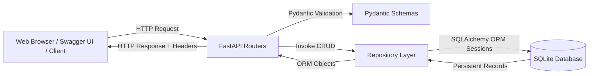

# Students Database CRUD Application
### Internship Assignment — EWB Edu Tech Pvt. Ltd.

[](https://www.python.org/)
[](https://fastapi.tiangolo.com/)
[](https://www.sqlite.org/)
[](https://www.sqlalchemy.org/)
[](https://docs.pydantic.dev/)
[](https://pytest.org/)

---

## 1. Project Overview

The **Students Database CRUD Application** is a production-grade, high-performance academic administration platform designed to manage student records with strict data integrity, persistent relational storage, and comprehensive input validation. Built using **Python**, **FastAPI**, **SQLAlchemy ORM**, **Pydantic v2**, and **SQLite**, the application delivers both a robust RESTful API and a modern web dashboard.

The application strictly enforces unique constraints (duplicate email prevention), input sanitization (handling whitespace, dates of birth, and formatted phone numbers), and structured error responses following standard HTTP status codes.

---

## 2. Problem Statement

Educational institutions and training providers frequently face data management challenges with student registration:
- **Data Redundancy & Collisions**: Inconsistent registration systems allow duplicate student profiles with identical emails.
- **Data Corruption & Validation Errors**: Accepting malformed email addresses, future dates of birth, or blank names degrades data quality.
- **Lack of Persistence in Prototypes**: Many prototype tools rely on temporary in-memory arrays or client-side storage, causing critical data loss upon server reboots.
- **Poor API Ergonomics**: APIs that lack structured error reporting, filtering, and pagination make client integrations brittle.

This project solves these issues by providing a centralized, SQLite-persisted, schema-validated CRUD system with a clean administrative dashboard.

---

## 3. Objectives

- **Create**: Securely register new student profiles with schema and database-level validation.
- **Read & List**: Fetch student records with substring search by name, filtering by course, and limit/offset pagination.
- **Retrieve Profile**: Inspect individual student details by unique ID.
- **Update (PUT & PATCH)**: Support both full-entity replacement (PUT) and granular field-level modification (PATCH).
- **Delete**: Permanently remove student records with HTTP 204 No Content response after explicit confirmation.
- **Data Persistence**: Ensure all records are safely stored in a persistent SQLite database across server restarts.
- **Reliable Testing**: Provide 100% automated test coverage across health checks, CRUD operations, edge cases, and database persistence using isolated test databases.

---

## 4. Features

- **Full RESTful CRUD Suite**: Endpoints for creating, reading, listing, updating, and deleting student records.
- **Unique Email Enforcement**: Database-level unique index and repository-level pre-checks preventing collisions (HTTP 409 Conflict).
- **Strict Input Validation**: Rejection of empty names, whitespace, invalid email formats, pre-1900 dates, and future birth dates (HTTP 422).
- **Flexible Searching & Filtering**: Search students by name (case-insensitive substring) and filter by academic program.
- **Pagination with Total Reporting**: Limit and offset pagination with total matching count exposed in the `X-Total-Count` header.
- **Web Administration Dashboard**: Modern, responsive UI with live KPI stats cards, student directory table, modal forms, and toast notifications.
- **Zero Mock Data**: All displayed records and statistics are queried live from the SQLite database.

---

## 5. Technology Stack

| Layer | Technology | Purpose |
| :--- | :--- | :--- |
| **Backend Framework** | [FastAPI](https://fastapi.tiangolo.com/) | Asynchronous, OpenAPI-compliant REST API framework |
| **Application Server** | [Uvicorn](https://www.uvicorn.org/) | Lightning-fast ASGI web server |
| **Database** | [SQLite](https://www.sqlite.org/) | Serverless, zero-configuration persistent relational database |
| **ORM Layer** | [SQLAlchemy 2.0](https://www.sqlalchemy.org/) | Declarative object-relational mapping and session management |
| **Data Validation** | [Pydantic v2](https://docs.pydantic.dev/) | Strict schema validation, sanitization, and data coercion |
| **Test Suite** | [Pytest](https://pytest.org/) & [HTTPX](https://www.python-httpx.org/) | Automated test execution with isolated in-memory test database |
| **Admin UI (Frontend)**| Vanilla HTML5, CSS3 & JavaScript | Interactive admin dashboard communicating directly with FastAPI |

---

## 6. System Architecture

The codebase follows a modular layered architecture separating concerns between configuration, database connection, ORM models, Pydantic schemas, database repository logic, and API route controllers:

```
EWB AIML/
├── app/
│   ├── __init__.py           # Application package marker
│   ├── config.py             # Pydantic Settings (environment configuration)
│   ├── database.py           # Engine setup, sessionmaker, get_db dependency, init_db
│   ├── models.py             # SQLAlchemy Student ORM model with table schema
│   ├── schemas.py            # Pydantic validation models (Create, PUT, PATCH, Response)
│   ├── crud.py               # Repository layer with safe ORM query execution & rollback
│   ├── exceptions.py         # Custom domain exceptions for clean error abstraction
│   ├── routers/
│   │   ├── __init__.py       # Routers package marker
│   │   ├── health.py         # System health check (GET /health) and root welcome (GET /)
│   │   └── students.py       # Full CRUD endpoints (/students)
│   ├── static/               # Academic administration web interface
│   │   ├── css/
│   │   │   └── style.css     # Clean responsive dashboard stylesheet
│   │   ├── js/
│   │   │   └── app.js        # Vanilla JS client calling real FastAPI endpoints
│   │   └── index.html        # Academic administration dashboard HTML
│   └── main.py               # FastAPI entry point, lifespan events, CORS, and static mount
├── tests/
│   ├── __init__.py           # Tests package marker
│   ├── conftest.py           # Pytest fixtures, in-memory SQLite setup, TestClient
│   ├── test_integration_live.py # End-to-end integration test suite
│   └── test_students.py      # Core unit and domain test suite
├── .gitignore                # Comprehensive Git ignore rules (DBs, envs, cache)
├── requirements.txt          # Production and testing runtime dependencies
└── README.md                 # Project documentation and developer guide
```

### Architectural Data Flow



---

## 7. Database Design & ORM Modeling

The entity model is mapped to the `students` table in the SQLite database:

| Field | Type | Constraints | Description |
| :--- | :--- | :--- | :--- |
| `id` | Integer | Primary Key, Autoincrement, Index | Unique student identifier |
| `name` | String(100) | Not Null, Index | Full name (min 2 chars, whitespace-trimmed) |
| `date_of_birth`| Date | Not Null | Date of birth (1900 <= DOB <= today) |
| `email` | String(255) | Not Null, Unique, Index | Case-insensitive normalized email address |
| `phone` | String(25) | Nullable | Contact number (7–25 digits/symbols) |
| `course` | String(100) | Nullable, Index | Academic program/major |
| `address` | Text | Nullable | Residential address |
| `enrollment_date`| Date | Nullable | Date of enrollment |
| `created_at` | DateTime | Not Null, Server Default Now | Audit creation timestamp |
| `updated_at` | DateTime | Not Null, Auto-updating Now | Audit update timestamp |

---

## 8. CRUD Workflow Interaction with SQLite

1. **Initialization (`init_db`)**:
   - On server startup, FastAPI invokes `lifespan(app)`.
   - `Base.metadata.create_all(bind=engine)` issues `CREATE TABLE IF NOT EXISTS students (...)` to SQLite.
   - If `students.db` exists, existing records remain untouched.

2. **Session Lifecycle (`get_db`)**:
   - FastAPI dependency injection yields an isolated `SessionLocal` instance per HTTP request.
   - For thread safety in SQLite, the engine uses `connect_args={"check_same_thread": False}`.
   - When the request completes, the `finally:` block executes `db.close()`, cleanly returning the connection to the pool.

3. **Create (`POST /students`)**:
   - Validates fields via Pydantic; checks email uniqueness.
   - Inserts row using parameterized ORM SQL statements. On commit, SQLite assigns the autoincrement integer `id`.

4. **Read & List (`GET /students`)**:
   - Constructs ORM queries filtered by `Student.name.ilike(...)` and `Student.course.ilike(...)`.
   - Returns paginated slices using `.offset(offset).limit(limit).all()`.

5. **Update (`PUT` & `PATCH` `/students/{id}`)**:
   - **PUT**: Replaces all editable fields with validated payload.
   - **PATCH**: Updates only provided fields using `student_in.model_dump(exclude_unset=True)`.
   - Validates that email changes do not conflict with existing records.

6. **Delete (`DELETE /students/{id}`)**:
   - Deletes record via `db.delete(db_student)` and commits. Returns HTTP 204 No Content.

---

## 9. Prerequisites

- **Python**: Version `3.10`, `3.11`, or `3.12` installed.
- **pip**: Python package installer.
- **Git**: For version control.

---

## 10. Installation & Virtual Environment Setup

### Step 1: Open the Project Directory
```powershell
cd "C:\Users\hi\Desktop\EWB AIML"
```

### Step 2: Create a Virtual Environment

**On Windows (PowerShell):**
```powershell
python -m venv .venv
.\.venv\Scripts\Activate.ps1
```

**On Windows (Command Prompt):**
```cmd
python -m venv .venv
.\.venv\Scripts\activate.bat
```

**On Linux / macOS:**
```bash
python3 -m venv .venv
source .venv/bin/activate
```

### Step 3: Install Dependencies
```bash
pip install --upgrade pip
pip install -r requirements.txt
```

---

## 11. Execution Instructions

Start the application with Uvicorn:

```bash
uvicorn app.main:app --host 127.0.0.1 --port 8000 --reload
```

### Available URLs
- **Web Dashboard**: [http://127.0.0.1:8000/dashboard](http://127.0.0.1:8000/dashboard) (or [http://127.0.0.1:8000/](http://127.0.0.1:8000/))
- **Interactive Swagger Docs**: [http://127.0.0.1:8000/docs](http://127.0.0.1:8000/docs)
- **ReDoc Documentation**: [http://127.0.0.1:8000/redoc](http://127.0.0.1:8000/redoc)
- **System Health Check**: [http://127.0.0.1:8000/health](http://127.0.0.1:8000/health)

---

## 12. API Endpoint Reference

| Method | Endpoint | Status | Description |
| :--- | :--- | :--- | :--- |
| `GET` | `/` | 200 / 307 | API welcome response (redirects browser to `/dashboard`) |
| `GET` | `/health` | 200 OK | System and SQLite connectivity health check |
| `POST` | `/students` | 201 Created | Register a new student record |
| `GET` | `/students` | 200 OK | List students with search, filter, and pagination |
| `GET` | `/students/{student_id}` | 200 OK | Retrieve student profile by ID |
| `PUT` | `/students/{student_id}` | 200 OK | Full replacement of student details |
| `PATCH`| `/students/{student_id}` | 200 OK | Partial update of supplied fields |
| `DELETE`| `/students/{student_id}` | 204 No Content | Permanently delete student record |
| `GET` | `/dashboard` | 200 OK | Web administration interface |

---

## 13. Automated Testing Instructions

All tests run using Pytest against an isolated in-memory test database (`sqlite:///:memory:`) using SQLAlchemy's `StaticPool`. Tests never modify or delete the application database (`students.db`).

### Execute All Tests:
```bash
pytest -v
```

### Verified Test Results Evidence:
```text
============================= test session starts =============================
platform win32 -- Python 3.12.0, pytest-9.1.1, pluggy-1.6.0
rootdir: C:\Users\hi\Desktop\EWB AIML
plugins: anyio-4.14.2, langsmith-0.11.0, asyncio-1.4.0
collected 22 items

tests/test_integration_live.py::test_frontend_delivery PASSED            [  4%]
tests/test_integration_live.py::test_backend_health PASSED               [  9%]
tests/test_integration_live.py::test_full_crud_workflow_isolated PASSED  [ 13%]
tests/test_students.py::test_health_check PASSED                         [ 18%]
tests/test_students.py::test_welcome_endpoint PASSED                     [ 22%]
tests/test_students.py::test_create_student_success PASSED               [ 27%]
tests/test_students.py::test_list_students_with_search_filter_pagination PASSED [ 31%]
tests/test_students.py::test_retrieve_student_by_id PASSED               [ 36%]
tests/test_students.py::test_update_student_put PASSED                   [ 40%]
tests/test_students.py::test_update_student_patch PASSED                 [ 45%]
tests/test_students.py::test_delete_student PASSED                       [ 50%]
tests/test_students.py::test_student_not_found PASSED                    [ 54%]
tests/test_students.py::test_duplicate_email_rejection PASSED            [ 59%]
tests/test_students.py::test_invalid_input_rejection[name--at least 2 characters] PASSED [ 63%]
tests/test_students.py::test_invalid_input_rejection[name-   -Student name cannot be empty] PASSED [ 68%]
tests/test_students.py::test_invalid_input_rejection[name-A-at least 2 characters] PASSED [ 72%]
tests/test_students.py::test_invalid_input_rejection[email-not-a-valid-email-valid email address] PASSED [ 77%]
tests/test_students.py::test_invalid_input_rejection[email-@missinguser.com-valid email address] PASSED [ 81%]
tests/test_students.py::test_invalid_input_rejection[date_of_birth-2099-01-01-cannot be in the future] PASSED [ 86%]
tests/test_students.py::test_invalid_input_rejection[date_of_birth-1890-05-10-cannot be prior to the year 1900] PASSED [ 90%]
tests/test_students.py::test_invalid_input_rejection[phone-invalid-phone-abc!@#-Phone number must contain] PASSED [ 95%]
tests/test_students.py::test_database_persistence PASSED                 [100%]

============================= 22 passed in 0.81s ==============================
```

---

## 14. GitHub Upload Instructions

Repository: [https://github.com/srikarbabuvaddi-star/EWB-AI-ML.git](https://github.com/srikarbabuvaddi-star/EWB-AI-ML.git)

To push this project to your repository, run:

```bash
git branch -M main
git remote add origin https://github.com/srikarbabuvaddi-star/EWB-AI-ML.git
git add .
git commit -m "feat: complete Students Database CRUD application with backend, SQLite persistence, test suite, and dashboard"
git push -u origin main
```

*(If `origin` already exists, update it with `git remote set-url origin https://github.com/srikarbabuvaddi-star/EWB-AI-ML.git` before pushing).*

---

## 15. Limitations

- **File-Level Concurrency in SQLite**: SQLite uses database-level locks during write operations; for enterprise deployments handling thousands of concurrent writes, an external RDBMS like PostgreSQL is recommended.
- **Unauthenticated Access**: As required by the assignment, authentication (JWT/OAuth2) is intentionally omitted to focus on core CRUD integrity and database persistence.
- **Embedded Frontend**: Assets are served directly via FastAPI static mounting; high-scale applications typically deploy frontend bundles via a CDN.

---

## 16. Future Enhancements

- **Role-Based Access Control (RBAC)**: JWT authentication with Admin, Registrar, and Student roles.
- **CSV/Excel Export & Bulk Import**: Allow bulk registry updates.
- **Audit History**: Historical audit logging of modifications.
- **Alembic Database Migrations**: Declarative migration scripts for schema evolution.
- **Docker Containerization**: `Dockerfile` and `docker-compose.yml` for zero-configuration container deployment.

---

## 17. License & Attribution

Developed as an Internship Assignment for **EWB Edu Tech Pvt. Ltd.**  
All student sample records used in demonstrations and tests are completely fictional and synthetic.
