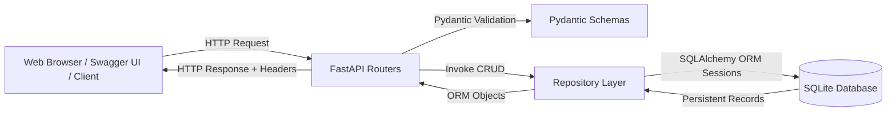

# Students Database CRUD Application
### Internship Assignment — EWB Edu Tech Pvt. Ltd.

[](https://www.python.org/)
[](https://fastapi.tiangolo.com/)
[](https://www.sqlite.org/)
[](https://www.sqlalchemy.org/)
[](https://docs.pydantic.dev/)
[](https://pytest.org/)

---

## 1. Project Overview

The **Students Database CRUD Application** is a production-ready, high-performance academic administration platform designed to manage student records with data integrity, persistent storage, and strict validation. Built using **Python**, **FastAPI**, **SQLAlchemy ORM**, **Pydantic v2**, and **SQLite**, the application delivers both a robust RESTful API and an administrative web dashboard.

The application strictly enforces unique constraints (such as duplicate email prevention), input sanitization (handling whitespace, dates of birth, and formatted phone numbers), and structured error responses following standard HTTP status codes.

---

## 2. Objectives

- **Create**: Securely register new student profiles with schema and database-level validation.
- **Read & List**: Fetch student records with substring search by name, filtering by course, and limit/offset pagination.
- **Retrieve Profile**: Inspect individual student details by unique ID.
- **Update (PUT & PATCH)**: Support both full-entity replacement (PUT) and granular field-level modification (PATCH).
- **Delete**: Permanently remove student records with HTTP 204 No Content response.
- **Data Persistence**: Ensure all records are safely stored in a persistent SQLite database across server restarts.
- **Reliable Testing**: Provide 100% automated test coverage across health checks, CRUD operations, edge cases, and database persistence.

---

## 3. Technology Stack

| Layer | Technology | Purpose |
| :--- | :--- | :--- |
| **Backend Framework** | [FastAPI](https://fastapi.tiangolo.com/) | Asynchronous, OpenAPI-compliant REST API framework |
| **Application Server** | [Uvicorn](https://www.uvicorn.org/) | Lightning-fast ASGI web server |
| **Database** | [SQLite](https://www.sqlite.org/) | Serverless, zero-configuration persistent relational database |
| **ORM Layer** | [SQLAlchemy 2.0](https://www.sqlalchemy.org/) | Declarative object-relational mapping and session management |
| **Data Validation** | [Pydantic v2](https://docs.pydantic.dev/) | Strict schema validation, sanitization, and data coercion |
| **Test Suite** | [Pytest](https://pytest.org/) & [HTTPX](https://www.python-httpx.org/) | Automated test execution with isolated in-memory test database |
| **Admin UI (Frontend)**| Vanilla HTML5, CSS3 & JavaScript | Interactive admin dashboard communicating directly with FastAPI |

---

## 4. Project Architecture

The codebase follows a modular layered architecture separating concerns between configuration, database connection, ORM models, Pydantic schemas, database repository logic, and API route controllers:

```
EWB AIML/
├── app/
│   ├── __init__.py           # Application package marker
│   ├── config.py             # Pydantic Settings (environment configuration)
│   ├── database.py           # Engine setup, sessionmaker, get_db dependency, init_db
│   ├── models.py             # SQLAlchemy Student ORM model with table schema
│   ├── schemas.py            # Pydantic validation models (Create, PUT, PATCH, Response)
│   ├── crud.py               # Repository layer with safe ORM query execution & rollback
│   ├── exceptions.py         # Custom domain exceptions for clean error abstraction
│   ├── routers/
│   │   ├── __init__.py       # Routers package marker
│   │   ├── health.py         # System health check (GET /health) and root welcome (GET /)
│   │   └── students.py       # Full CRUD endpoints (/students)
│   ├── static/               # Academic administration web interface
│   │   ├── css/
│   │   │   └── style.css     # Clean responsive dashboard stylesheet
│   │   ├── js/
│   │   │   └── app.js        # Vanilla JS client calling real FastAPI endpoints
│   │   └── index.html        # Academic administration dashboard HTML
│   └── main.py               # FastAPI entry point, lifespan events, CORS, and static mount
├── tests/
│   ├── __init__.py           # Tests package marker
│   ├── conftest.py           # Pytest fixtures, in-memory SQLite setup, TestClient
│   └── test_students.py      # Automated test suite (19 test cases covering 11 requirements)
├── .gitignore                # Comprehensive Git ignore rules (DBs, envs, cache)
├── requirements.txt          # Production and testing runtime dependencies
└── README.md                 # Project documentation and developer guide
```

### Architectural Data Flow



---

## 5. How CRUD Operations Interact with SQLite

Understanding how Python and SQLAlchemy interact with the SQLite database file:

1. **Initialization (`init_db`)**:
   - On server startup, FastAPI invokes `lifespan(app)`.
   - `Base.metadata.create_all(bind=engine)` issues `CREATE TABLE IF NOT EXISTS students (...)` to SQLite.
   - If `students.db` does not exist, SQLite automatically creates the database file. If it already exists, existing student records remain untouched.

2. **Session Lifecycle (`get_db`)**:
   - FastAPI dependency injection yields a distinct `SessionLocal` instance for every HTTP request.
   - In SQLite, multi-threading requires `connect_args={"check_same_thread": False}`.
   - When the request completes, the `finally:` block executes `db.close()`, returning the connection safely to the pool and preventing connection leaks.

3. **Create (`POST /students`)**:
   - Pydantic validates input types, trims whitespace from names, lowercases email, and rejects future birth dates.
   - The CRUD layer checks for pre-existing email records.
   - The ORM translates the object into an SQL statement:
     ```sql
     INSERT INTO students (name, date_of_birth, email, phone, course, address, enrollment_date, created_at, updated_at)
     VALUES (?, ?, ?, ?, ?, ?, ?, CURRENT_TIMESTAMP, CURRENT_TIMESTAMP);
     ```
   - On database commit, SQLite assigns an autoincrement integer `id` and stores the row on disk.

4. **Read & List (`GET /students`)**:
   - Queries are constructed using SQLAlchemy ORM expressions:
     ```python
     query = db.query(Student)
     if name:
         query = query.filter(Student.name.ilike(f"%{name}%"))
     if course:
         query = query.filter(Student.course.ilike(f"%{course}%"))
     students = query.order_by(Student.id.asc()).offset(offset).limit(limit).all()
     ```
   - Parameterized queries eliminate SQL injection vulnerabilities.
   - The total matching count is computed and returned in the `X-Total-Count` response header.

5. **Update (`PUT` & `PATCH` `/students/{id}`)**:
   - For **PUT**: All editable fields are updated with new validated data.
   - For **PATCH**: `student_in.model_dump(exclude_unset=True)` extracts only fields explicitly supplied in the request body.
   - If the email is being changed, the system validates that the target email is not already taken by another student.
   - `db.commit()` writes changes to disk; `db.refresh()` loads updated timestamps.

6. **Delete (`DELETE /students/{id}`)**:
   - `db.delete(db_student)` marks the row for deletion.
   - `db.commit()` commits the deletion in SQLite.
   - FastAPI returns HTTP `204 No Content`.

---

## 6. Prerequisites

- **Python**: Version `3.10`, `3.11`, or `3.12` installed.
- **pip**: Python package manager.
- **Git**: For version control.

---

## 7. Installation and Setup

### Step 1: Clone or Open the Repository
```bash
cd "C:\Users\hi\Desktop\EWB AIML"
```

### Step 2: Create a Virtual Environment

**On Windows (PowerShell):**
```powershell
python -m venv .venv
.\.venv\Scripts\Activate.ps1
```

**On Windows (Command Prompt):**
```cmd
python -m venv .venv
.\.venv\Scripts\activate.bat
```

**On Linux / macOS:**
```bash
python3 -m venv .venv
source .venv/bin/activate
```

### Step 3: Install Dependencies
```bash
pip install --upgrade pip
pip install -r requirements.txt
```

---

## 8. Database Configuration

The application uses an SQLite database file. By default, it creates and connects to:
```
sqlite:///./students.db
```
To customize the database location, you can set the `DATABASE_URL` environment variable or create a `.env` file in the project root:

```env
PROJECT_NAME="Students Database CRUD API"
DATABASE_URL="sqlite:///./students.db"
DEFAULT_PAGE_LIMIT=10
MAX_PAGE_LIMIT=100
```

---

## 9. How to Start the Backend

Start the Uvicorn ASGI server with automatic reload:

```bash
uvicorn app.main:app --host 127.0.0.1 --port 8000 --reload
```

Upon startup, the terminal will display:
```
INFO:     Started server process
INFO:     Waiting for application startup.
INFO:     Starting up Students Database CRUD API v1.0.0...
INFO:     Initializing database schema...
INFO:     Database schema initialized successfully.
INFO:     Database initialized.
INFO:     Application startup complete.
INFO:     Uvicorn running on http://127.0.0.1:8000 (Press CTRL+C to quit)
```

### Available URLs

- **API Welcome**: [http://127.0.0.1:8000/](http://127.0.0.1:8000/)
- **Health Check**: [http://127.0.0.1:8000/health](http://127.0.0.1:8000/health)
- **Interactive Swagger UI**: [http://127.0.0.1:8000/docs](http://127.0.0.1:8000/docs)
- **ReDoc Documentation**: [http://127.0.0.1:8000/redoc](http://127.0.0.1:8000/redoc)
- **Administration Dashboard**: [http://127.0.0.1:8000/dashboard](http://127.0.0.1:8000/dashboard)

---

## 10. API Endpoint Reference

| Method | Endpoint | Status | Description |
| :--- | :--- | :--- | :--- |
| `GET` | `/` | 200 OK | API welcome response and navigation links |
| `GET` | `/health` | 200 OK | System and SQLite connectivity health check |
| `POST` | `/students` | 201 Created | Register a new student record |
| `GET` | `/students` | 200 OK | List students with search, filter, and pagination |
| `GET` | `/students/{student_id}` | 200 OK | Retrieve student profile by ID |
| `PUT` | `/students/{student_id}` | 200 OK | Full replacement of student details |
| `PATCH`| `/students/{student_id}` | 200 OK | Partial update of supplied fields |
| `DELETE`| `/students/{student_id}` | 204 No Content | Permanently delete student record |
| `GET` | `/dashboard` | 200 OK | Web administration interface |

### Standard HTTP Status Codes

- `200 OK`: Request succeeded (GET, PUT, PATCH).
- `201 Created`: Student record created successfully (POST).
- `204 No Content`: Student deleted successfully (DELETE).
- `404 Not Found`: Target student ID does not exist in the database.
- `409 Conflict`: Duplicate email address collision.
- `422 Unprocessable Entity`: Input validation failure (e.g., empty name, invalid date, malformed email).
- `500 Internal Server Error`: Unexpected server or database failure (safe message returned, no stack traces leaked).

---

## 11. Example Requests and Responses

### 1. Create Student (`POST /students`)

**Request:**
```http
POST /students HTTP/1.1
Host: 127.0.0.1:8000
Content-Type: application/json

{
  "name": "Marcus Vance",
  "date_of_birth": "2002-04-12",
  "email": "marcus.vance@example.edu",
  "phone": "+1 555-0178",
  "course": "Computer Science",
  "address": "402 North Quad, Academic City",
  "enrollment_date": "2024-09-01"
}
```

**Response (HTTP 201 Created):**
```json
{
  "id": 1,
  "name": "Marcus Vance",
  "date_of_birth": "2002-04-12",
  "email": "marcus.vance@example.edu",
  "phone": "+1 555-0178",
  "course": "Computer Science",
  "address": "402 North Quad, Academic City",
  "enrollment_date": "2024-09-01",
  "created_at": "2026-10-25T06:15:00.000000Z",
  "updated_at": "2026-10-25T06:15:00.000000Z"
}
```

---

### 2. List & Filter Students (`GET /students?course=Computer%20Science&limit=10&offset=0`)

**Request:**
```http
GET /students?course=Computer%20Science&limit=10&offset=0 HTTP/1.1
Host: 127.0.0.1:8000
```

**Response (HTTP 200 OK):**
```http
HTTP/1.1 200 OK
Content-Type: application/json
X-Total-Count: 1

[
  {
    "id": 1,
    "name": "Marcus Vance",
    "date_of_birth": "2002-04-12",
    "email": "marcus.vance@example.edu",
    "phone": "+1 555-0178",
    "course": "Computer Science",
    "address": "402 North Quad, Academic City",
    "enrollment_date": "2024-09-01",
    "created_at": "2026-10-25T06:15:00.000000Z",
    "updated_at": "2026-10-25T06:15:00.000000Z"
  }
]
```

---

### 3. Partial Update (`PATCH /students/1`)

**Request:**
```http
PATCH /students/1 HTTP/1.1
Host: 127.0.0.1:8000
Content-Type: application/json

{
  "phone": "+1 555-9988",
  "course": "Artificial Intelligence"
}
```

**Response (HTTP 200 OK):**
```json
{
  "id": 1,
  "name": "Marcus Vance",
  "date_of_birth": "2002-04-12",
  "email": "marcus.vance@example.edu",
  "phone": "+1 555-9988",
  "course": "Artificial Intelligence",
  "address": "402 North Quad, Academic City",
  "enrollment_date": "2024-09-01",
  "created_at": "2026-10-25T06:15:00.000000Z",
  "updated_at": "2026-10-25T06:20:00.000000Z"
}
```

---

### 4. Duplicate Email Error (`POST /students`)

**Response (HTTP 409 Conflict):**
```json
{
  "detail": "A student with email 'marcus.vance@example.edu' already exists."
}
```

---

### 5. Input Validation Error (`POST /students` with future birth date)

**Response (HTTP 422 Unprocessable Entity):**
```json
{
  "detail": [
    {
      "type": "value_error",
      "loc": ["body", "date_of_birth"],
      "msg": "Value error, Date of birth cannot be in the future.",
      "input": "2099-01-01"
    }
  ]
}
```

---

### 6. Delete Student (`DELETE /students/1`)

**Response (HTTP 204 No Content):**
```http
HTTP/1.1 204 No Content
```

---

## 12. Swagger UI Testing Instructions

FastAPI provides an automatic, interactive API exploration interface:

1. Start the server using `uvicorn app.main:app --reload`.
2. Open your web browser and navigate to:
   ```
   http://127.0.0.1:8000/docs
   ```
3. **Test POST /students**:
   - Expand `POST /students` -> click **"Try it out"**.
   - Paste a sample JSON payload and click **"Execute"**.
   - Verify that HTTP `201 Created` is returned with the generated ID.
4. **Test Duplicate Email**:
   - Click **"Execute"** again with the identical payload.
   - Verify HTTP `409 Conflict` with the error message.
5. **Test GET /students**:
   - Expand `GET /students` -> click **"Try it out"**.
   - Enter a search keyword (e.g. `marcus`) or filter by course.
   - Click **"Execute"** and check the results and `X-Total-Count` header.
6. **Test PUT & PATCH**:
   - Test replacing all student details (PUT) or updating just the phone number (PATCH).
7. **Test DELETE /students/{id}**:
   - Enter the student ID and execute. Verify `204 No Content`.
   - Re-execute `GET /students/{id}` with the same ID to verify `404 Not Found`.

---

## 13. How to Run Automated Tests

The project includes 19 comprehensive pytest tests covering all 11 required assignment criteria. Tests use an isolated in-memory SQLite database (`sqlite:///:memory:`) so production and development data are never touched or modified.

### Run All Tests:
```bash
pytest -v
```

### Run Tests with Summary & Coverage:
```bash
pytest -v --tb=short
```

### Verified Test Results Evidence:
```text
============================= test session starts =============================
platform win32 -- Python 3.12.0, pytest-9.1.1, pluggy-1.6.0
rootdir: C:\Users\hi\Desktop\EWB AIML
plugins: anyio-4.14.2, langsmith-0.11.0, asyncio-1.4.0
collected 19 items

tests/test_students.py::test_health_check PASSED                         [  5%]
tests/test_students.py::test_welcome_endpoint PASSED                     [ 10%]
tests/test_students.py::test_create_student_success PASSED               [ 15%]
tests/test_students.py::test_list_students_with_search_filter_pagination PASSED [ 21%]
tests/test_students.py::test_retrieve_student_by_id PASSED               [ 26%]
tests/test_students.py::test_update_student_put PASSED                   [ 31%]
tests/test_students.py::test_update_student_patch PASSED                 [ 36%]
tests/test_students.py::test_delete_student PASSED                       [ 42%]
tests/test_students.py::test_student_not_found PASSED                    [ 47%]
tests/test_students.py::test_duplicate_email_rejection PASSED            [ 52%]
tests/test_students.py::test_invalid_input_rejection[name--at least 2 characters] PASSED [ 57%]
tests/test_students.py::test_invalid_input_rejection[name-   -Student name cannot be empty] PASSED [ 63%]
tests/test_students.py::test_invalid_input_rejection[name-A-at least 2 characters] PASSED [ 68%]
tests/test_students.py::test_invalid_input_rejection[email-not-a-valid-email-valid email address] PASSED [ 73%]
tests/test_students.py::test_invalid_input_rejection[email-@missinguser.com-valid email address] PASSED [ 78%]
tests/test_students.py::test_invalid_input_rejection[date_of_birth-2099-01-01-cannot be in the future] PASSED [ 84%]
tests/test_students.py::test_invalid_input_rejection[date_of_birth-1890-05-10-cannot be prior to the year 1900] PASSED [ 89%]
tests/test_students.py::test_invalid_input_rejection[phone-invalid-phone-abc!@#-Phone number must contain] PASSED [ 94%]
tests/test_students.py::test_database_persistence PASSED                 [100%]

============================= 19 passed in 0.61s ==============================
```

---

## 14. GitHub Upload Instructions

Follow these exact steps to push this project to your GitHub repository:

### Step 1: Initialize Git in the Project Root
```bash
git init
```

### Step 2: Stage All Valid Files
The `.gitignore` automatically excludes virtual environments (`.venv`), database files (`*.db`), and cache files (`__pycache__`).
```bash
git add .
```

### Step 3: Verify Staged Files
```bash
git status
```
Ensure no `.db` or `.venv` files are staged.

### Step 4: Create the Initial Commit
```bash
git commit -m "feat: complete students database CRUD application for EWB internship"
```

### Step 5: Link to Your GitHub Repository
1. Create a new repository on [GitHub](https://github.com/new) named `students-database-crud`.
2. Connect your local repository and push:
```bash
git branch -M main
git remote add origin https://github.com/<YOUR_GITHUB_USERNAME>/students-database-crud.git
git push -u origin main
```

---

## 15. Limitations

- **Single SQLite File Concurrency**: SQLite is an embedded database that locks during write operations; for enterprise deployments with thousands of concurrent write transactions, PostgreSQL or MySQL is recommended.
- **Unauthenticated API**: As specified by the assignment requirements, authentication (e.g. OAuth2 JWT) is not included to prioritize core CRUD reliability.
- **Client-Side Asset Delivery**: The frontend dashboard is bundled and served directly via FastAPI static file mounting; large production systems typically deploy frontend assets via a CDN.

---

## 16. Future Improvements

- **Authentication & RBAC**: Add JWT token authentication with role-based access control (Admin, Registrar, Student).
- **Bulk CSV Export / Import**: Enable administrators to bulk import or export student registries as CSV/Excel.
- **Audit Logging**: Add an audit trail table to log who updated student records and when.
- **Database Migrations with Alembic**: Integrate Alembic for forward and backward schema migrations.
- **Docker Containerization**: Provide a `Dockerfile` and `docker-compose.yml` for zero-configuration container deployment.

---

## 17. License & Attribution

Developed as an Internship Assignment for **EWB Edu Tech Pvt. Ltd.**  
All student sample records used in demonstrations and tests are completely fictional and synthetic.
